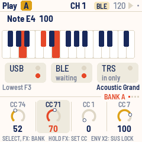
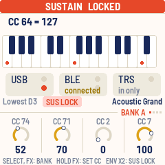
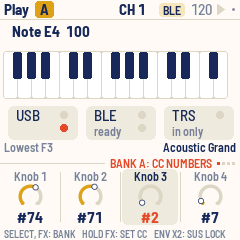
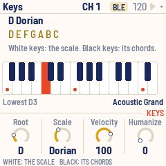
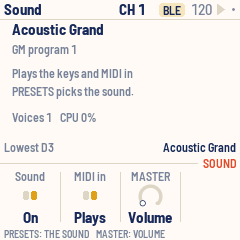
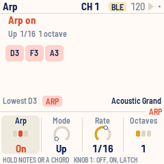
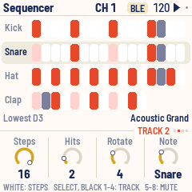
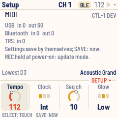
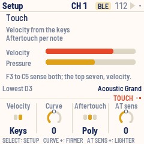
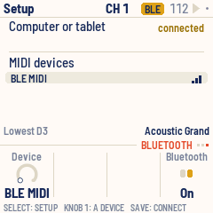

# CTL-1

CTL-1 turns your M-VAVE FM-1 into a MIDI controller. Play notes on the keys in any scale, with its chords
under the black keys. Send controllers from the knobs, in four banks. Run an arpeggiator and a four-track
Euclidean drum sequencer on its clock. Everything goes out over USB and Bluetooth, and MIDI from the TRS
jack is passed along. The FM-1 also plays it all on its own General MIDI sounds, so it works with nothing
connected. If you like, the keys can sense how hard you play them, for velocity and aftertouch.

, running CTL-1, each control labeled")

---

## Contents

1. Install
2. Getting started
3. Controls
4. The screen
5. Playing
6. Knobs and banks
7. Scales and chords
8. Sound
9. Arpeggiator
10. Sequencer
11. Clock and transport
12. Setup
13. MIDI
14. Saving
15. Troubleshooting
16. Parameters
17. Credits

---

## 1. Install

To try CTL-1 first, open the [CTL-1 emulator](https://charlesvestal.github.io/fm1-ctl/emu/). It runs the
same code in your browser, with sound, and you can play it with a mouse, a touch screen or the computer
keyboard. In Chrome or Edge, it can send to your MIDI ports too.

To install it, open the [web installer](https://charlesvestal.github.io/fm1-ctl/install/) in Chrome or
Edge. Connect the FM-1 with a USB data cable and press Install. Don't unplug it while it's writing. When
it's done, the FM-1 restarts into CTL-1.

To go back to M-VAVE's firmware, use "Back to the stock firmware" at the bottom of the same page.
Download the FM-1 V15 file from the link there, choose it and press the button. M-VAVE's own updater,
M-UPGRADE, works too.

> Installing other firmware is at your own risk. If the FM-1 ever won't start, see
> [Recovering an FM-1 that won't start](#recovering-an-fm-1-that-won-t-start).

<details><summary>Install from the command line</summary>

Download the firmware file (`ctl-VERSION.fwsc`) from the
[releases page](https://github.com/charlesvestal/fm1-ctl/releases) and get the CTL-1 source from GitHub.
Install Python 3 with `pip3 install mido python-rtmidi`, then run:

```
python3 base/tools/fm1_install.py ctl-VERSION.fwsc
```

</details>

---

## 2. Getting started

1. **Connect.** Plug the FM-1 into a computer with a USB data cable. It shows up as a MIDI device named
   "CTL-1 FM-1". A Mac that knew the FM-1 with other firmware may keep the old name until you remove it
   in Audio MIDI Setup.
2. **Play.** The keys play notes from F3, and the FM-1 plays them too, on a piano. Press OCT− or OCT+ to
   move the keys an octave.
3. **Turn KNOB 1–4.** On the Play page they send four controllers: cutoff, resonance, modulation and
   volume. Press FX for the next of four banks.
4. **Pick a sound.** Turn PRESETS to send a program change, and the FM-1's own sound follows it. Turn
   ALGORITHM to set the MIDI channel.
5. **Choose a scale.** Press SEL, then turn KNOB 2. Now the white keys play the scale and the black keys
   play its chords.
6. **Arpeggiate.** Press ARP and turn KNOB 1 to On, then hold a chord.
7. **Add drums.** Press SEQ and PLAY to start four Euclidean drum tracks on channel 10. Turn KNOB 1–4 to
   shape the selected track.

CTL-1 saves your settings by itself a few seconds after you change something.

---

## 3. Controls

The drawing at the top shows every control. Here they are in more detail.

| Control | What it does |
|---|---|
| Keys | Play notes, chromatic from F3. With a scale, the white keys play its notes and the black keys its chords. On the Sequencer page, they edit the steps instead |
| OCT− / OCT+ | Move the keys an octave down or up, from −3 to +3 |
| KNOB 1–4 | Set the four values at the bottom of the screen. On the Play page, they send four controllers |
| SELECT | Steps through the current page's own pages: the knob banks on Play, the tracks on the Sequencer, Touch on Setup |
| ALGORITHM | Sets the MIDI channel, 1 to 16 |
| PRESETS | Sends a program change, 1 to 128, and the FM-1's own sound follows it |
| MASTER | Sets the volume of the FM-1's sound, or sends a controller (Sound page) |
| HOME | Opens the Play page |
| SEL | Opens the Keys page: root, scale, velocity, humanize |
| ARP | Opens the Arp page |
| SEQ | Opens the Sequencer page |
| EDIT | Opens the Sound page |
| GLO | Opens the Setup page: tempo, clock, sequencer channel and glow. Its Touch page reads velocity and aftertouch from the keys |
| FX | Moves to the next knob bank, A to D. Hold it and turn KNOB 1–4 to set the bank's controller numbers |
| ENV | Holds sustain while you hold it. Tap it twice to lock sustain on, and press it again to unlock |
| LFO | Works as a mod wheel. It rises while you hold it and falls when you let go |
| PLAY | Starts or stops the sequencer, and sends MIDI start or stop |
| REC | Panic: all notes off |
| SAVE | Saves now |

Each page has its own button, and that button lights while you're on the page.

---

## 4. The screen




- The top bar shows the page's name, and on Play, the knob bank's letter in a chip. The MIDI channel
  is in the middle, and the tempo with a play triangle is on the right. The triangle is dark while
  playing and flashes on each beat. When the clock comes from outside, "EXT" replaces the tempo. A dot
  at the far right means there are unsaved changes. Messages such as "KNOB BANK B" or "SAVED" fill the
  bar for about a second.
- The middle of the screen shows what the page is about. Each page is described below.
- The status line shows the lowest key's note, then "ARP" or "LATCH" while the arpeggiator is on,
  "SUSTAIN" (or "SUS LOCK") and "MOD". On the right is the program, by name.
- On the knob row's rule, a tag says what the knobs edit ("BANK A", "KEYS", "TRACK 2"…). Dots beside it
  stand for the four banks on Play, the four tracks on the Sequencer and Setup's two pages. Under it are
  KNOB 1–4, each with its name, a dial and its value. A setting with only a few positions shows a row of
  pips instead of a dial. The one you turned last stands out for a moment.
- The footer says what the page's buttons and keys do.

The current page's button is lit brightly. So is LFO while the mod wheel is up, ENV while sustain is
on, and OCT− or OCT+ while the octave is shifted. PLAY flashes green on each beat while playing. The
keys light while you hold them and when a note arrives over MIDI. Every other button glows dimly, so you
can read its label in the dark (Setup, Glow). With a scale, the root keys glow too.

---

## 5. Playing

The 27 keys play notes from F3 to G5 at octave 0. Press OCT− and OCT+ to move them an octave at a time,
and the status line tells you the lowest key's note. A note you're holding ends correctly even if you
change the octave before you let go.

- **Velocity** comes from the keys at first. Touch is on, so they sense how hard you play them, and
  they can send aftertouch. Set Touch's Velocity to Fixed, and every note plays at the Keys page's
  Velocity (KNOB 3), which starts at 100. For details, see [Touch](#touch).
- To sustain, hold ENV. It sends controller 64 on, and off when you let go. **Tap ENV twice** quickly to
  lock sustain on ("SUS LOCK"). Press ENV again to unlock it, and sustain ends when you let go. REC
  unlocks it too.
- To use the mod wheel, hold LFO. Controller 1 rises from 0 to 127 over a sixteenth note, and falls
  back just as fast when you let go. On the FM-1's sounds, it adds vibrato.
- To change the channel, turn ALGORITHM. Notes you're holding end first, on the channel they started on.
- To send a program change, turn PRESETS. Each step sends one, and the FM-1's sound follows.
- To stop every note, press REC. It ends every held note and sends sustain off and "all notes off" on
  the keyboard's channel and the sequencer's.

The Play page shows the last message you sent, the keys, and the three ports. Each port has a light for
MIDI coming in, and USB and Bluetooth also have one for MIDI going out. Under BLE, it says "connected"
while a computer, a tablet or a Bluetooth MIDI device is connected, and "ready" while none is.

---

## 6. Knobs and banks

On the Play page, KNOB 1–4 send controllers in four banks of four, 16 in all. Press FX or turn SELECT
to move through banks A, B, C and D. Each knob remembers its value in each bank, so it picks up where
you left it.

| Bank | KNOB 1 | KNOB 2 | KNOB 3 | KNOB 4 |
|---|---|---|---|---|
| A | 74 cutoff | 71 resonance | 1 modulation | 7 volume |
| B | 73 attack | 72 release | 75 decay | 76 vibrato |
| C | 16 | 17 | 18 | 19 |
| D | 20 | 21 | 22 | 23 |

To use your own numbers, hold FX and turn KNOB 1–4. While you hold FX, they set the current bank's four
controller numbers (0 to 119), and letting go doesn't change the bank. To set another bank, tap FX to
reach it first.



Turn a knob slowly to move one step a click. Turn it quickly to move up to six.

---

## 7. Scales and chords

Press SEL to open the Keys page.



| Knob | Sets |
|---|---|
| KNOB 1 Root | C to B |
| KNOB 2 Scale | Chromatic, Major, Minor, Dorian, Mixolydian, Harmonic minor, Pentatonic, Pentatonic minor, Blues |
| KNOB 3 Velocity | 1 to 127 |
| KNOB 4 Humanize | 0 to 40. Spreads the velocity of the arpeggiator and sequencer at random |

**Chromatic** is the default, and the keys work like a normal keyboard. With any other scale:

- The **white keys** play the scale's notes in order, from the root in octave 3. Every white key sounds
  right. The keys that play the root glow, so you can see where each octave starts.
- The **black keys** play chords, the triad on each step of the scale. In C major that's C, Dm, Em, F,
  G, Am, B°, then C an octave up.

Changing the root or scale ends any notes you're holding.

---

## 8. Sound

CTL-1 has the 128 General MIDI sounds and the drum kit (on channel 10), from Sonivox EAS. They play
whatever CTL-1 plays, from the keys, the arpeggiator and the sequencer, through the FM-1's speaker and
headphone jack. Turn PRESETS to pick the sound on the keyboard's channel.

Press EDIT to open the Sound page. It shows the sound that's playing, how many voices are sounding and
how busy the processor is.



| Knob | Sets |
|---|---|
| KNOB 1 Sound | On or Off |
| KNOB 2 MIDI in | Plays or Ignored: whether MIDI coming in plays the sounds too |
| KNOB 3 MASTER | Volume, or a controller number for the MASTER knob to send |

**MASTER** has a fixed range, unlike KNOB 1–4, which turn endlessly. When it's set to Volume (the
default), it sets the volume of the FM-1's sounds. When you give it a controller number, it sends 0 to
127 across its travel, only when it moves, and the sounds play at full volume.

Up to 24 notes can sound at once.

---

## 9. Arpeggiator

Press ARP to open the Arp page, and turn KNOB 1 there to switch the arpeggiator on. While it's on, the
keys don't sound directly. Hold notes or a chord, and it plays them one at a time, in tempo. With a
scale, one black key gives you a whole chord to arpeggiate.



| Knob | Sets |
|---|---|
| KNOB 1 Arp | Off, On or Latch |
| KNOB 2 Mode | Up, Down, Up-down, Random, As played |
| KNOB 3 Rate | 1/4, 1/8, 1/8 triplet, 1/16, 1/16 triplet, 1/32 |
| KNOB 4 Octaves | 1 to 3: the notes repeated in higher octaves |

- With **On**, it plays while you hold keys and stops when you let go.
- With **Latch**, it keeps playing after you let go. Let go of everything and play a new chord to
  replace the old one.

Each note lasts half a step. The arpeggiator follows the clock whether or not the sequencer is playing,
on the same grid, so the two stay in time. A chord you play between steps starts on the next one.

---

## 10. Sequencer

Press SEQ to open the Sequencer page. It has four drum tracks of sixteenth notes on the sequencer's
channel, which is 10 by default. Each row on the screen is one track.



| Track | Note | Steps | Hits |
|---|---|---|---|
| 1 | 36 Kick | 16 | 4 |
| 2 | 38 Snare | 16 | 2, turned 4 steps |
| 3 | 42 Hat | 16 | 8 |
| 4 | 39 Clap | 12 | 3, turned 2 steps |

KNOB 1–4 set the selected track:

| Knob | Sets |
|---|---|
| KNOB 1 Steps | 1 to 16: the track's length |
| KNOB 2 Hits | How many steps play |
| KNOB 3 Rotate | Turns the pattern, step by step |
| KNOB 4 Note | The note it plays. On channel 10, the screen shows the drum's name |

The hits are spread as evenly as possible over the steps, which makes a Euclidean rhythm. Tracks of
different lengths drift against each other, so you get longer, shifting patterns.

You can also edit by hand. On this page, the keys edit instead of playing.

- Press a **white key** to turn one of the selected track's 16 steps on or off.
- Press **black keys 1–4** to select a track (SELECT does this too).
- Press **black keys 5–8** to mute or unmute tracks 1–4.

Turning Steps, Hits or Rotate rebuilds the pattern from those numbers, and replaces any steps you set by
hand. So set the numbers first, then fine-tune with the keys. The lights show the pattern: steps that
play are bright, empty ones are dim, and the step playing now is flipped.

Press PLAY to start and stop it, always from step 1. Velocity comes from the Keys page, spread by
Humanize.

---

## 11. Clock and transport

CTL-1 keeps a clock at 24 ticks a beat, and the arpeggiator and sequencer run on it. Set the tempo (40
to 240 BPM) and the clock's source on the Setup page:

| Clock | What happens |
|---|---|
| Int | CTL-1 keeps time and sends MIDI clock over USB. The default |
| Int, quiet | CTL-1 keeps time but sends no clock |
| Ext | CTL-1 follows MIDI clock and start / stop from USB or the TRS jack |

PLAY starts and stops the sequencer. With an internal clock, it also sends MIDI start and stop, so a DAW
or drum machine that follows the clock starts with it. With Ext, incoming start and stop drive the
sequencer, the Tempo knob does nothing, and the screen shows "EXT".

---

## 12. Setup

Press GLO to open the Setup page. It counts the MIDI messages each port has carried in and out (USB,
Bluetooth, TRS), so you can quickly check that a cable or a connection works. The version is at the
top right.



| Knob | Sets |
|---|---|
| KNOB 1 Tempo | 40 to 240 BPM |
| KNOB 2 Clock | Int, Int quiet, Ext |
| KNOB 3 Seq ch | The sequencer's MIDI channel, 1 to 16 |
| KNOB 4 Glow | Off, Low or High: how brightly unlit buttons glow |

### Touch

The FM-1's keys have no velocity sensors, but under each key is a carbon pill whose resistance falls as
you press harder. CTL-1 can read it, so the keys play with velocity and aftertouch, with no change to the
hardware. It's on at first, with aftertouch for each note. To open the Touch page, turn SELECT on the
Setup page.



| Knob | Sets |
|---|---|
| KNOB 1 Velocity | Fixed: every note at the Keys page's Velocity. Keys: velocity from how hard you play |
| KNOB 2 Curve | −5 to +5. Higher means you play harder to reach 127; lower, softer playing reaches it |
| KNOB 3 Aftertouch | Off; Poly, pressure for each note; or Channel, one pressure for the channel |
| KNOB 4 AT sens | −5 to +5. Higher means a lighter lean gives full aftertouch |

The page shows the last note's velocity and the pressure right now, so you can see what your playing
sends.

- Where you press matters as much as how hard. Press near the bottom edge of a key and it plays softer
  than in the middle, on every key. It's the most reliable way to play quietly.
- The keys sense in two zones. F3 to C5 read how hard the key lands, with the widest range, and sense
  aftertouch too. The top seven keys read it another way. Their soft end is narrower, firm presses all
  come out near the top, and they have no aftertouch.
- A note plays about 5 ms after the key goes down, once its velocity is read.
- Aftertouch counts from where the key comes to rest after the note, so a key you only hold sends
  nothing. Press harder to send more, and ease off to send less.
- Poly aftertouch goes to each note of a chord key. While the arpeggiator is on, aftertouch goes to the
  whole channel.
- The arpeggiator and the sequencer keep the Keys page's Velocity, spread by Humanize.
- On the Sequencer page, the keys edit steps as usual, the moment they go down.
- A lit LED changes the reading of the keys beside it. So while you hold a key, the lights in its column
  go dark each time it's read, and they look slightly dimmer.

### Bluetooth

To open the Bluetooth page, turn SELECT twice on the Setup page. The top half is for a computer, phone
or tablet that connects to the FM-1, and it says whether one is connected. For how to connect, see
section 13. The bottom half finds Bluetooth MIDI devices for CTL-1 to connect to itself, such as a
synth, a pedal or a controller.



1. Put the device in its pairing mode. It appears in the list, with bars for its signal.
2. Turn KNOB 1 to pick it, and press SAVE. The top bar says CONNECTING, then CONNECTED.
3. Press SAVE again to let it go.

Everything CTL-1 plays goes to the device and to a connected computer alike. Turn KNOB 4 to switch
Bluetooth off or on. CTL-1 starts with it the way you left it.

---

## 13. MIDI

- Over **USB**, CTL-1 is a class-compliant MIDI device called "CTL-1 FM-1". Everything CTL-1 plays goes
  out here, and MIDI comes in.
- Over **Bluetooth**, it's a Bluetooth MIDI device called "FM-1", on from the moment CTL-1 starts.
  Everything CTL-1 plays goes out here too, and MIDI comes in. What arrives over USB is passed on to
  Bluetooth, and what arrives over Bluetooth is passed on to USB.
- The **TRS jack** is MIDI in only, since the FM-1 has no MIDI out jack. What arrives is passed on to
  USB and Bluetooth.
- **MIDI in**, from any of them, lights the keys and drives the clock when it's set to Ext. It also
  plays the FM-1's sounds, unless the Sound page says Ignored.

To connect over Bluetooth on a Mac, open Audio MIDI Setup and choose Window > Show MIDI Studio. Click
the Bluetooth button, then click Connect next to FM-1. On an iPad or iPhone, connect from a music app's
Bluetooth MIDI settings (in GarageBand, Settings > Advanced > Bluetooth MIDI Devices). The top bar says
COMPUTER CONNECTED, the Play page's BLE port says "connected", and the Setup page counts what has passed.

CTL-1 sends these messages, on the keyboard's channel unless noted:

| Action | Message |
|---|---|
| Key | Note on (velocity from the Keys page, or from the key with Touch on), note off |
| Pressing a held key (Touch) | Poly aftertouch for each of its notes, or channel aftertouch |
| KNOB 1–4 on Play | Control change: the bank's controller |
| MASTER | Control change: the Sound page's controller (when it has one) |
| PRESETS | Program change |
| ENV | Control change 64: 127, then 0 |
| LFO | Control change 1, rising to 127 over a sixteenth, then back to 0 |
| REC | Note offs, control change 64 = 0 and 123 = 0 (also on the sequencer's channel) |
| Arpeggiator | Note on and off |
| Sequencer | Note on and off on the sequencer's channel |
| Clock (Int) | MIDI clock, 24 a beat |
| PLAY (Int, Int quiet) | MIDI start / stop |

CTL-1 passes on channel messages and real-time messages (clock, start, stop), but not SysEx.

---

## 14. Saving

CTL-1 saves by itself about four seconds after a change, once nothing is held and the sequencer is
stopped. Saving pauses the FM-1 for a moment, so it waits until you stop playing. A dot at the top right
means there are unsaved changes. Press SAVE to save right away.

Everything on the pages is saved: the knob banks and their values, the scale, sound, arpeggiator and
sequencer tracks, the channel, program, tempo and octave, and Setup.

---

## 15. Troubleshooting

To put the FM-1 in update mode, hold REC while you switch it on. If you installed m-bootloader with the
web installer, the installer can reach the FM-1 from there, and holding PLAY instead opens
m-bootloader's recovery menu. Without m-bootloader, REC starts the chip's own update mode, which only
the rescue below can reach.

If a button or knob does the wrong thing, calibrate the panel. Hold OCT− and OCT+ while you switch the
FM-1 on, and the screen asks you to press each button and turn each knob in turn.

If CTL-1 crashes, it shows a red CRASH screen and restarts by itself a few seconds later. If you report
the problem, include the numbers on that screen (a photo is easiest) and what you were doing.

If CTL-1 crashes twice in a row while starting, it starts in SAFE MODE instead. There's no sound, but
USB works, so the web installer can reach it. Reinstall CTL-1, or put the stock firmware back from the
same page. Press PLAY to try starting CTL-1 normally again. If even safe mode fails twice, the FM-1
drops into the chip's own update mode, and only the rescue below can reach it.

If CTL-1 ever crashes while Bluetooth is running, the next start leaves Bluetooth off and says
"BLUETOOTH OFF AFTER A CRASH". Everything else works. To start Bluetooth again, press SAVE on the
Bluetooth page, or hold SAVE on the Setup page. It starts by itself again at the next restart.

If a Mac won't connect over Bluetooth, check Audio MIDI Setup's Bluetooth window after you click
Connect. If it doesn't show FM-1 as connected, quit Audio MIDI Setup (⌘Q), open it again and click
Connect once more. Audio MIDI Setup can lose touch with the Mac's MIDI service, and then it links to the
FM-1 without starting its MIDI. When that happens, the Bluetooth page says "connected", with "No MIDI
yet" in red under it. While it lasts, no other computer or tablet can find the FM-1.

If the computer shows another name, it may be a Mac that knew the FM-1 with other firmware and kept the
old name. Remove the FM-1 in Audio MIDI Setup (Window > Show MIDI Studio) and plug it in again.

### Recovering an FM-1 that won't start

An FM-1 in the chip's own update mode shows a blank screen, and neither the web installer nor M-VAVE's
updater can see it. A script can put M-VAVE's firmware back, on a Mac, with the USB cable you already
have.

Open Terminal, paste this line and press Return:

```
bash -c "$(curl -fsSL https://raw.githubusercontent.com/hugelton/felucca-bsp/main/tools/fm1_rescue.sh)"
```

1. If a window asks to install the command line developer tools, click Install. When it's finished,
   paste the line again.
2. If it asks for a password, type your Mac password (nothing shows as you type) and press Return.
3. When it says it's waiting, plug the FM-1 in and switch it on. The script catches it and checks the
   chip. It saves a backup of the FM-1's memory in the `fm1-rescue` folder in your home folder, and
   asks before it writes anything.
4. Type **yes** and press Return. Don't unplug anything until it says it's restarting the FM-1. The
   FM-1 then starts into its original firmware, and you can install CTL-1 again from there.

The script downloads M-VAVE's FM-1 V15 firmware and JieLi's flash loader, and checks both against known
fingerprints. It writes only the firmware area of the memory, never the bootloader or the FM-1's own
settings, and it checks everything it writes. Running it again is always safe. If it fails, copy
everything in the Terminal window and [open an issue](https://github.com/charlesvestal/fm1-ctl/issues).
If the FM-1 never shows up at all, Felucca's
[FM-1-transporter](https://github.com/kurogedelic/FM-1-transporter) can still reach it. It's a small
RP2040 board wired to the USB lines.

---

## 16. Parameters

| Page | Value | Range | Default |
|---|---|---|---|
| Play | KNOB 1–4 | 0–127, per bank | 64 (modulation 0, volume 100) |
| Play (FX held) | Controller numbers | 0–119, per bank | A: 74 71 1 7, B: 73 72 75 76, C: 16–19, D: 20–23 |
| Keys | Root | C – B | C |
| Keys | Scale | 9 scales | Chromatic |
| Keys | Velocity | 1–127 | 100 |
| Keys | Humanize | 0–40 | 0 |
| Arp | Arp | Off, On, Latch | Off |
| Arp | Mode | Up, Down, Up-down, Random, As played | Up |
| Arp | Rate | 1/4 – 1/32 | 1/16 |
| Arp | Octaves | 1–3 | 1 |
| Sequencer | Steps, Hits, Rotate, Note | per track | see [Sequencer](#s10) |
| Sound | Sound | On, Off | On |
| Sound | MIDI in | Plays, Ignored | Plays |
| Sound | MASTER | Volume, CC 1–119 | Volume |
| Setup | Tempo | 40–240 BPM | 120 |
| Setup | Clock | Int, Int quiet, Ext | Int |
| Setup | Seq ch | 1–16 | 10 |
| Setup | Glow | Off, Low, High | Low |
| Setup, Touch | Velocity | Fixed, Keys | Keys |
| Setup, Touch | Curve | −5 – +5 | 0 |
| Setup, Touch | Aftertouch | Off, Poly, Channel | Poly |
| Setup, Touch | AT sens | −5 – +5 | 0 |
| ALGORITHM | Channel | 1–16 | 1 |
| PRESETS | Program | 1–128 | 1 (Acoustic Grand) |
| OCT− / OCT+ | Octave | −3 – +3 | 0 |

---

## 17. Credits

CTL-1 is free software under the Mozilla Public License 2.0. If you share a changed version, you must
also share the source of the files you changed.

- The platform (the hardware layer, USB, update loader, installer and storage) is
  [fm1-base](https://github.com/charlesvestal/fm1-base) on [felucca-bsp](https://github.com/hugelton/felucca-bsp).
  It comes from **Felucca** by Leo Kuroshita (Hügelton Instruments), by way of
  [X0X](https://charlesvestal.github.io/fm1-x0x/) and [FoMni-1](https://charlesvestal.github.io/fm1-fomni/).
  The top bar and knob row come from X0X.
- Bluetooth runs on **JieLi's Bluetooth libraries** from the AC79 SDK (Apache-2.0, Zhuhai Jieli Technology).
- The General MIDI sounds are **Sonivox EAS** and its 200 KB sound set (Apache-2.0, Sonic Network and
  the Android Open Source Project).
- The Euclidean rhythms use Godfried Toussaint's reading of Bjorklund's algorithm.
- Touch is the key sensing from [Velo](https://github.com/charlesvestal/fm1-velocity), as tuned for
  [MONK-1](https://charlesvestal.github.io/fm1-monk/).
- The idea of running FM-1 firmware in the browser comes from [Groove OS](https://www.groove-os.com/).
- The fonts are Barlow Semi Condensed and Terminus (SIL Open Font License).

M-VAVE and FM-1 are trademarks of their owners. CTL-1 is not affiliated with M-VAVE or Hügelton
Instruments.
