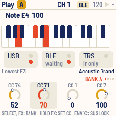
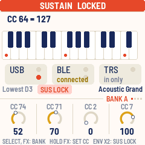
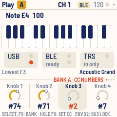
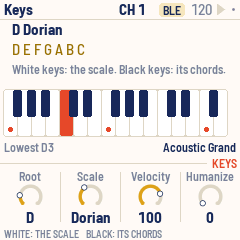
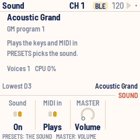
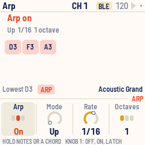
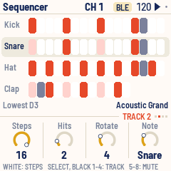
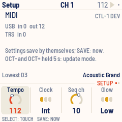
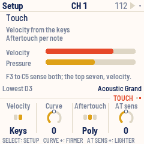

# CTL-1

CTL-1 turns the M-VAVE FM-1 into a MIDI controller. The keys play notes, in any scale with its chords
under the black keys; the knobs send controllers in four banks; an arpeggiator and a four-track
Euclidean drum sequencer run on its clock. Everything goes out over USB, MIDI from the TRS jack is passed
along, and the FM-1 plays it all on its own General MIDI sounds too, so it works with nothing connected.
If you like, the keys can also sense how hard you play them, for velocity and aftertouch.

, running CTL-1, each control labelled")

---

## Contents

1. Install
2. Getting started
3. Controls
4. The screen
5. Playing
6. Knobs and banks
7. Scales and chords
8. Sound
9. Arpeggiator
10. Sequencer
11. Clock and transport
12. Setup
13. MIDI
14. Saving
15. Troubleshooting
16. Parameters
17. Credits

---

## 1. Install

**Try it first:** the [CTL-1 emulator](https://charlesvestal.github.io/fm1-ctl/emu/) runs the same
code in the browser, with sound, played with the mouse, a touch screen or the computer keyboard. In
Chrome or Edge it can send to your MIDI ports, too.

**Install:** open the [web installer](https://charlesvestal.github.io/fm1-ctl/install/) in Chrome or
Edge, connect the FM-1 with a USB data cable and press Install. Don't unplug it while it's
writing; when it finishes, the FM-1 restarts into CTL-1.

**Go back:** "Back to the stock firmware", at the bottom of the same page, puts M-VAVE's firmware
back (download the FM-1 V15 file from the link there, choose it, press the button). M-VAVE's own
updater, M-UPGRADE, works too.

> Installing other firmware is at your own risk. If the FM-1 ever won't start, see
> [Recovering an FM-1 that won't start](#recovering-an-fm-1-that-won-t-start).

<details><summary>Install from the command line</summary>

Download the firmware file (for example `ctl-usb-0.9.fwsc`) from the
[releases page](https://github.com/charlesvestal/fm1-ctl/releases), get the CTL-1 source from GitHub,
install Python 3 with `pip3 install mido python-rtmidi`, and run:

```
python3 tools/fm1_install.py ctl-usb-0.9.fwsc
```

</details>

---

## 2. Getting started

1. **Connect.** Plug the FM-1 into a computer with a USB data cable. It shows up as a MIDI device named
   "CTL-1 FM-1" (a Mac that knew the FM-1 with other firmware may keep the old name until you remove
   it in Audio MIDI Setup).
2. **Play.** The keys play notes from F3, and the FM-1 plays them too, on a piano. OCT− and OCT+ move
   the keys an octave.
3. **Turn KNOB 1–4.** On the Play page they send four controllers: cutoff, resonance, modulation and
   volume. Press FX for the next of four banks.
4. **Pick a sound.** Turn PRESETS: a program change goes out, and the FM-1's own sound follows it.
   ALGORITHM sets the MIDI channel.
5. **Choose a scale.** Press SEL, then turn KNOB 2. Now the white keys play the scale and the black keys
   its chords.
6. **Arpeggiate.** Press ARP and turn KNOB 1 to On; hold a chord.
7. **Add drums.** Press SEQ and PLAY: four Euclidean drum tracks on channel 10. KNOB 1–4 shape the
   selected track.

CTL-1 saves your settings by itself a few seconds after a change.

---

## 3. Controls

The drawing at the top shows them all; here they are in more detail.

| Control | What it does |
|---|---|
| Keys | Notes, chromatic from F3; or, with a scale, its notes on the white keys and its chords on the black keys. On the Sequencer page they edit the steps instead |
| OCT− / OCT+ | The keys an octave down or up, from −3 to +3 |
| KNOB 1–4 | The four values at the bottom of the screen; on the Play page, four controllers |
| SELECT | The current page's own pages: the knob banks on Play, the tracks on the Sequencer, Touch on Setup |
| ALGORITHM | MIDI channel, 1 to 16 |
| PRESETS | Program change, 1 to 128; the FM-1's own sound follows it |
| MASTER | The volume of the FM-1's sound, or a controller (Sound page) |
| HOME | Play page |
| SEL | Keys page: root, scale, velocity, humanize |
| ARP | Arp page |
| SEQ | Sequencer page |
| GLO | Sound page |
| EDIT | Setup page: tempo, clock, sequencer channel, glow; and Touch: velocity and aftertouch from the keys |
| FX | The next knob bank, A to D. Held: KNOB 1–4 set the bank's controller numbers |
| ENV | Sustain while held. Tap it twice to lock sustain on; press it again to unlock |
| LFO | Mod wheel: rises while held, falls when let go |
| PLAY | Start or stop the sequencer, and send MIDI start or stop |
| REC | Panic: all notes off |
| SAVE | Save now |

Each page has its own button, and that button lights while you're on the page.

---

## 4. The screen




- **Top bar:** the page's name (on Play, the knob bank's letter in a chip), the MIDI channel in the
  middle, and the tempo with a play triangle on the right. The triangle is dark while playing and
  flashes on each beat; "EXT" replaces the tempo when the clock comes from outside. A dot at the far
  right means there are unsaved changes. Messages, such as "KNOB BANK B" or "SAVED", fill the bar for
  about a second.
- **The page:** what it's about (each page below).
- **Status line:** the lowest key's note; "ARP" or "LATCH" while the arpeggiator is on, "SUSTAIN" (or
  "SUS LOCK") and "MOD"; and on the right the program, by name.
- **Knob row:** on its rule, a tag says what the knobs edit ("BANK A", "KEYS", "TRACK 2"…), with dots
  for the four banks on Play, the four tracks on the Sequencer and Setup's two pages. Under it, KNOB 1–4: each one's name,
  a dial (a row of pips for a setting with a few positions) and its value. The one you turned last
  stands out for a moment.
- **Footer:** what the page's buttons and keys do.

**The lights:** the current page's button is bright, as are LFO while the mod wheel is up, ENV while
sustain is on, and OCT− or OCT+ while the octave is shifted. PLAY flashes green on each beat while
playing. The keys light while you hold them and when a note arrives over MIDI. Every other button
glows dimly so its label can be read in the dark (Setup, Glow); with a scale, so do the root keys.

---

## 5. Playing

The 27 keys play notes from F3 to G5 at octave 0. OCT− and OCT+ move them an octave at a time; the
status line says which note is the lowest key. A note already held ends correctly even if you change
the octave before letting go.

- **Velocity** is fixed at first: every note plays at the Keys page's Velocity (KNOB 3), 100 to start
  with. With Touch on, the keys sense how hard you play them instead, and can send aftertouch. For
  details, see [Touch](#touch).
- **Sustain:** hold ENV. It sends controller 64 on, and off when you let go. **Tap ENV twice** quickly
  to lock sustain on ("SUS LOCK"); press ENV again to unlock, and sustain ends when you let go. REC
  unlocks it too.
- **Mod wheel:** hold LFO. Controller 1 rises from 0 to 127 over a sixteenth note, and falls back just
  as fast when you let go. On the FM-1's sounds it adds vibrato.
- **Channel:** turn ALGORITHM. Held notes end first, on the channel they started on.
- **Program change:** turn PRESETS. Each step sends a program change, and the FM-1's sound follows.
- **Panic:** press REC. It ends every held note and sends sustain off and "all notes off" on the
  keyboard's channel and the sequencer's.

The Play page shows the last message you sent, the keys, and the two ports, each with a light for MIDI
coming in and, for USB, one for MIDI going out.

---

## 6. Knobs and banks

On the Play page, KNOB 1–4 send controllers: four banks of four, 16 in all. Press FX, or turn SELECT,
for banks A, B, C and D. Each knob remembers its value in each bank, so it picks up where you left it.

| Bank | KNOB 1 | KNOB 2 | KNOB 3 | KNOB 4 |
|---|---|---|---|---|
| A | 74 cutoff | 71 resonance | 1 modulation | 7 volume |
| B | 73 attack | 72 release | 75 decay | 76 vibrato |
| C | 16 | 17 | 18 | 19 |
| D | 20 | 21 | 22 | 23 |

**Your own numbers:** hold FX and turn KNOB 1–4. While FX is held they set the current bank's four
controller numbers (0 to 119), and letting go doesn't change the bank. Tap FX to reach another bank first.



Turning a knob slowly moves one step a click; turning it quickly moves up to six.

---

## 7. Scales and chords

Press SEL for the Keys page.



| Knob | Sets |
|---|---|
| KNOB 1 Root | C to B |
| KNOB 2 Scale | Chromatic, Major, Minor, Dorian, Mixolydian, Harmonic minor, Pentatonic, Pentatonic minor, Blues |
| KNOB 3 Velocity | 1 to 127 |
| KNOB 4 Humanize | 0 to 40: a random spread of velocity for the arpeggiator and sequencer |

**Chromatic** is the default: the keys work like a normal keyboard. With any other scale:

- **White keys** play the scale's notes in order, from the root in octave 3. Every white key sounds
  right. The keys that play the root glow, so you can see where each octave starts.
- **Black keys** play chords: the triad on each step of the scale. In C major that's C, Dm, Em, F, G,
  Am, B°, then C an octave up.

Changing the root or scale ends any held notes.

---

## 8. Sound

CTL-1 has the 128 General MIDI sounds and the drum kit (on channel 10), from Sonivox EAS. They play
whatever CTL-1 plays (the keys, the arpeggiator, the sequencer) through the FM-1's speaker and
headphone jack. PRESETS picks the sound on the keyboard's channel.

Press GLO for the Sound page. It shows the sound playing, how many voices sound and how busy the
processor is.



| Knob | Sets |
|---|---|
| KNOB 1 Sound | On or Off |
| KNOB 2 MIDI in | Plays or Ignored: whether MIDI coming in plays the sounds too |
| KNOB 3 MASTER | Volume, or a controller number for the MASTER knob to send |

**MASTER** has a fixed range, unlike KNOB 1–4, which turn endlessly. Set to Volume (the default), it's
the volume of the FM-1's sounds. Given a controller number, it sends 0 to 127 across its travel, only
when it moves, and the sounds play at full volume.

Up to 24 notes sound at once.

---

## 9. Arpeggiator

Press ARP for the Arp page; KNOB 1 there turns the arpeggiator on. While it's on the keys don't sound
directly: hold notes or a chord and it plays them one at a time, in tempo. With a scale, one black key
is a whole chord to arpeggiate.



| Knob | Sets |
|---|---|
| KNOB 1 Arp | Off, On or Latch |
| KNOB 2 Mode | Up, Down, Up-down, Random, As played |
| KNOB 3 Rate | 1/4, 1/8, 1/8 triplet, 1/16, 1/16 triplet, 1/32 |
| KNOB 4 Octaves | 1 to 3: the notes repeated in higher octaves |

- **On:** it plays while you hold keys and stops when you let go.
- **Latch:** it keeps playing after you let go. The next chord, after letting go of everything,
  replaces the old one.

Each note lasts half a step. The arpeggiator follows the clock whether or not the sequencer is playing,
on the same grid, so the two stay in time: a chord played between steps starts on the next one.

---

## 10. Sequencer

Press SEQ for the Sequencer page: four drum tracks of sixteenth notes on the sequencer's channel, 10 by
default. Each row on screen is one track.



| Track | Note | Steps | Hits |
|---|---|---|---|
| 1 | 36 Kick | 16 | 4 |
| 2 | 38 Snare | 16 | 2, turned 4 steps |
| 3 | 42 Hat | 16 | 8 |
| 4 | 39 Clap | 12 | 3, turned 2 steps |

KNOB 1–4 set the selected track:

| Knob | Sets |
|---|---|
| KNOB 1 Steps | 1 to 16: the track's length |
| KNOB 2 Hits | How many steps play |
| KNOB 3 Rotate | Turns the pattern, step by step |
| KNOB 4 Note | The note it plays; on channel 10 the screen shows the drum's name |

The hits are spread as evenly as possible over the steps (a Euclidean rhythm). Tracks of different
lengths drift against each other, which makes longer, shifting patterns.

**By hand:** on this page the keys edit instead of playing.

- **White keys** turn the selected track's 16 steps on or off.
- **Black keys 1–4** select a track (so does SELECT).
- **Black keys 5–8** mute or unmute tracks 1–4.

Turning Steps, Hits or Rotate rebuilds the pattern from those numbers, replacing steps set by hand: set
the numbers first, then fine-tune with the keys. The lights show the pattern: steps that play bright,
empty ones dim, the step playing now flipped.

PLAY starts and stops it, always from step 1. Velocity comes from the Keys page, spread by Humanize.

---

## 11. Clock and transport

CTL-1 keeps a clock at 24 ticks a beat; the arpeggiator and sequencer run on it. Set the tempo (40 to
240 BPM) and the clock's source on the Setup page:

| Clock | What happens |
|---|---|
| Int | CTL-1 keeps time and sends MIDI clock over USB. The default |
| Int, quiet | CTL-1 keeps time but sends no clock |
| Ext | CTL-1 follows MIDI clock and start / stop from USB or the TRS jack |

PLAY starts and stops the sequencer. With an internal clock it also sends MIDI start and stop, so a DAW
or drum machine following the clock starts with it. With Ext, incoming start and stop drive the
sequencer, the Tempo knob rests, and the screen shows "EXT".

---

## 12. Setup

Press EDIT for the Setup page. It also shows the MIDI counted in and out of each port, and the version.



| Knob | Sets |
|---|---|
| KNOB 1 Tempo | 40 to 240 BPM |
| KNOB 2 Clock | Int, Int quiet, Ext |
| KNOB 3 Seq ch | The sequencer's MIDI channel, 1 to 16 |
| KNOB 4 Glow | Off, Low or High: how brightly unlit buttons glow |

### Touch

The FM-1's keys have no velocity sensors, but under each key is a carbon pill whose resistance falls
as you press harder. CTL-1 can read it, so the keys play with velocity and aftertouch, with no change
to the hardware. It's on at first, with aftertouch for each note. On the Setup page, turn SELECT for
the Touch page.



| Knob | Sets |
|---|---|
| KNOB 1 Velocity | Fixed: every note at the Keys page's Velocity. Keys: velocity from how hard you play |
| KNOB 2 Curve | −5 to +5. Higher means you play harder to reach 127; lower, softer playing reaches it |
| KNOB 3 Aftertouch | Off; Poly, pressure for each note; or Channel, one pressure for the channel |
| KNOB 4 AT sens | −5 to +5. Higher means a lighter lean gives full aftertouch |

The page shows the last note's velocity and the pressure now, so you can see what your playing sends.

- Where you press matters as much as how hard. Pressing near the bottom edge of a key plays
  softer than the middle, on every key: the most reliable way to play quietly.
- The keys sense in two zones. F3 to C5 read how hard the key lands, with the widest range, and
  sense aftertouch too. The top seven read it another way: their soft end is narrower, firm
  presses all come out near the top, and they have no aftertouch.
- A note plays about 5 ms after the key goes down, once its velocity is read.
- Aftertouch counts from where the key comes to rest after the note, so a key that's only held sends
  nothing. Press harder to send more; ease off to send less.
- Poly aftertouch goes to each note of a chord key. While the arpeggiator is on, aftertouch is the
  channel's.
- The arpeggiator and the sequencer keep the Keys page's Velocity, spread by Humanize.
- On the Sequencer page the keys edit steps as usual, the moment they go down.
- A lit LED changes the reading of the keys beside it, so while you hold a key, the lights in its
  column go dark each time it's read. They look slightly dimmer.

---

## 13. MIDI

- **USB:** a class-compliant MIDI device, "CTL-1 FM-1": everything CTL-1 plays goes out here, and MIDI
  comes in.
- **TRS jack:** MIDI in only (the FM-1 has no MIDI out jack). What arrives is passed on to USB.
- **MIDI in** (from either) lights the keys, drives the clock when it's set to Ext, and plays the FM-1's
  sounds unless the Sound page says Ignored.

Bluetooth MIDI comes in a later version.

What CTL-1 sends, on the keyboard's channel unless noted:

| Action | Message |
|---|---|
| Key | Note on (velocity from the Keys page, or from the key with Touch on), note off |
| Pressing a held key (Touch) | Poly aftertouch for each of its notes, or channel aftertouch |
| KNOB 1–4 on Play | Control change: the bank's controller |
| MASTER | Control change: the Sound page's controller (when it has one) |
| PRESETS | Program change |
| ENV | Control change 64: 127, then 0 |
| LFO | Control change 1, rising to 127 over a sixteenth, then back to 0 |
| REC | Note offs, control change 64 = 0 and 123 = 0 (also on the sequencer's channel) |
| Arpeggiator | Note on and off |
| Sequencer | Note on and off on the sequencer's channel |
| Clock (Int) | MIDI clock, 24 a beat |
| PLAY (Int, Int quiet) | MIDI start / stop |

CTL-1 passes on channel messages and real-time messages (clock, start, stop), not SysEx.

---

## 14. Saving

CTL-1 saves by itself about four seconds after a change, once nothing is held and the sequencer is
stopped: saving pauses the FM-1 for a moment, so it waits until you stop playing. A dot at the top
right means there are unsaved changes. Press SAVE to save at once.

Everything on the pages is saved: the knob banks and their values, scale, sound, arpeggiator, sequencer
tracks, channel, program, tempo, octave and Setup.

---

## 15. Troubleshooting

**Update mode:** hold OCT− and OCT+ together for five seconds. A countdown appears; let go before it
ends to cancel.

**Calibration:** if a button or knob does the wrong thing, hold OCT− and OCT+ while you switch the
FM-1 on. The screen then asks you to press each button and turn each knob in turn.

**After a crash:** CTL-1 shows a red CRASH screen and restarts by itself a few seconds later. If you
report the problem, include the numbers on that screen (a photo is easiest) and what you were doing.

**Safe mode:** if CTL-1 crashes twice in a row while starting, it starts in SAFE MODE instead. There's
no sound, but USB works, so the web installer can reach it: reinstall CTL-1, or put the stock firmware
back from the same page. Press PLAY to try starting CTL-1 normally again. If even safe mode fails
twice, the FM-1 drops into the chip's own update mode, and only the rescue below can reach it.

**The computer shows another name:** a Mac that knew the FM-1 with other firmware may keep the old
name. Remove the FM-1 in Audio MIDI Setup (Window > Show MIDI Studio) and plug it in again.

### Recovering an FM-1 that won't start

An FM-1 in the chip's own update mode shows a blank screen, and neither the web installer nor M-VAVE's
updater can see it. A script can put M-VAVE's firmware back, on a Mac, with the USB cable you already
have.

Open Terminal, paste this line and press Return:

```
bash -c "$(curl -fsSL https://raw.githubusercontent.com/charlesvestal/fm1-ctl/main/tools/fm1_rescue.sh)"
```

1. If a window asks to install the command line developer tools, click Install. When it has finished,
   paste the line again.
2. If it asks for a password, type your Mac password (nothing shows as you type) and press Return.
3. When it says it's waiting, plug the FM-1 in and switch it on. The script catches it, checks the
   chip, saves a backup of the FM-1's memory in the `fm1-rescue` folder in your home folder, and asks
   before it writes anything.
4. Type **yes** and press Return. Don't unplug anything until it says it's restarting the FM-1. The
   FM-1 then starts into its original firmware, and you can install CTL-1 again from there.

The script downloads M-VAVE's FM-1 V15 firmware and JieLi's flash loader, and checks both against known
fingerprints. It writes only the firmware area of the memory, never the bootloader or the FM-1's own
settings, and checks everything it writes. Running it again is always safe. If it fails, copy
everything in the Terminal window and [open an issue](https://github.com/charlesvestal/fm1-ctl/issues).
If the FM-1 never shows up at all, Felucca's
[FM-1-transporter](https://github.com/kurogedelic/FM-1-transporter) (a small RP2040 board wired to the
USB lines) can still reach it.

---

## 16. Parameters

| Page | Value | Range | Default |
|---|---|---|---|
| Play | KNOB 1–4 | 0–127, per bank | 64 (modulation 0, volume 100) |
| Play (FX held) | Controller numbers | 0–119, per bank | A: 74 71 1 7, B: 73 72 75 76, C: 16–19, D: 20–23 |
| Keys | Root | C – B | C |
| Keys | Scale | 9 scales | Chromatic |
| Keys | Velocity | 1–127 | 100 |
| Keys | Humanize | 0–40 | 0 |
| Arp | Arp | Off, On, Latch | Off |
| Arp | Mode | Up, Down, Up-down, Random, As played | Up |
| Arp | Rate | 1/4 – 1/32 | 1/16 |
| Arp | Octaves | 1–3 | 1 |
| Sequencer | Steps, Hits, Rotate, Note | per track | see [Sequencer](#s10) |
| Sound | Sound | On, Off | On |
| Sound | MIDI in | Plays, Ignored | Plays |
| Sound | MASTER | Volume, CC 1–119 | Volume |
| Setup | Tempo | 40–240 BPM | 120 |
| Setup | Clock | Int, Int quiet, Ext | Int |
| Setup | Seq ch | 1–16 | 10 |
| Setup | Glow | Off, Low, High | Low |
| Setup, Touch | Velocity | Fixed, Keys | Keys |
| Setup, Touch | Curve | −5 – +5 | 0 |
| Setup, Touch | Aftertouch | Off, Poly, Channel | Poly |
| Setup, Touch | AT sens | −5 – +5 | 0 |
| ALGORITHM | Channel | 1–16 | 1 |
| PRESETS | Program | 1–128 | 1 (Acoustic Grand) |
| OCT− / OCT+ | Octave | −3 – +3 | 0 |

---

## 17. Credits

CTL-1 is free software under the GNU General Public License, version 3. If you share the firmware, you
must also share its source code.

- The platform (hardware layer, USB, update loader, installer and storage) is from **Felucca** by Leo
  Kuroshita, Hügelton Instruments, by way of [X0X](https://charlesvestal.github.io/fm1-x0x/) and
  [FoMni-1](https://charlesvestal.github.io/fm1-fomni/). The top bar and knob row come from X0X.
- The General MIDI sounds are **Sonivox EAS** and its 200 KB sound set (Apache-2.0, Sonic Network and
  the Android Open Source Project).
- The Euclidean rhythms are Godfried Toussaint's reading of Bjorklund's algorithm.
- Touch is the key sensing from [Velo](https://github.com/charlesvestal/fm1-velocity), as tuned for
  [MONK-1](https://charlesvestal.github.io/fm1-monk/).
- The idea of running FM-1 firmware in the browser comes from [Groove OS](https://www.groove-os.com/).
- The fonts are Barlow Semi Condensed and Terminus (SIL Open Font License).

M-VAVE and FM-1 are trademarks of their owners. CTL-1 is not connected with M-VAVE or Hügelton
Instruments.
